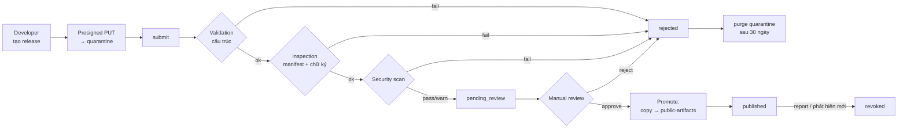
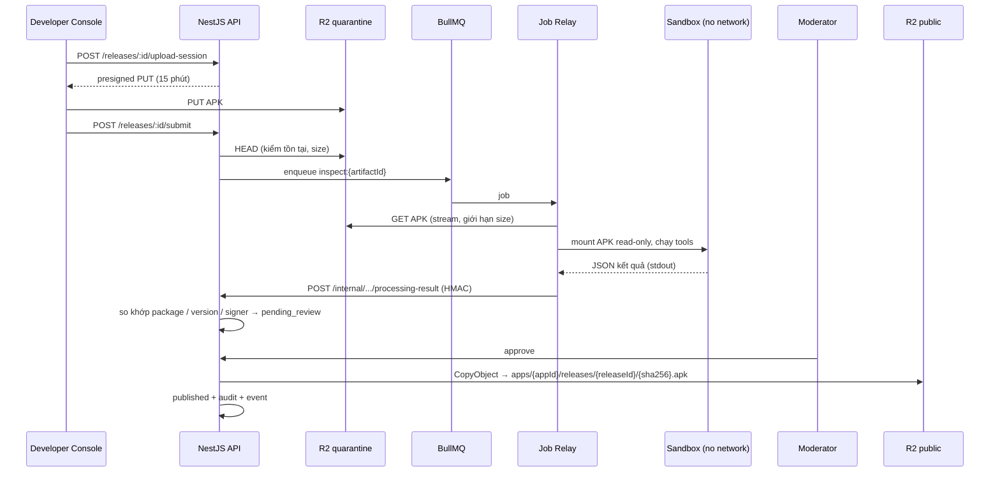

# NovaStore — APK Security Pipeline

> Draft v0.1 · 2026-10-19 · Đây là tài liệu quan trọng nhất của MVP.

> **Lưu ý cốt lõi:** quét tự động **không** bảo đảm APK an toàn. Pipeline này giảm rủi ro bằng nhiều lớp: kiểm tra cấu trúc → kiểm tra danh tính/chữ ký → quy tắc manifest → quét chữ ký malware → kiểm duyệt thủ công → giám sát & thu hồi sau phát hành.

## 1. Mô hình đe dọa

| # | Mối đe dọa | Tác nhân | Kiểm soát |
|---|-----------|----------|-----------|
| T1 | Phát tán malware/spyware | Developer độc hại | Scan + manual review + report + revoke |
| T2 | Chiếm đoạt cập nhật (update hijack) — đăng APK cùng package nhưng khóa ký khác | Kẻ tấn công | Khóa package name + signer lineage; client đối chiếu chữ ký |
| T3 | Mạo danh app nổi tiếng | Developer độc hại | Blocklist package/tên, so sánh tên & icon tương tự, xác minh sở hữu |
| T4 | Tấn công hạ tầng qua file độc (zip bomb, path traversal, parser exploit) | Bất kỳ ai upload | Giới hạn kích thước/tỉ lệ nén, worker sandbox không mạng, không quyền |
| T5 | Đánh tráo file sau duyệt | Nội bộ/kẻ xâm nhập | Artifact bất biến, SHA-256, key chứa hash, versioning R2, audit log |
| T6 | Tải APK chưa duyệt qua URL đoán được | Người dùng | Quarantine private, key ngẫu nhiên, chỉ signed URL cho bản published |
| T7 | Moderator thông đồng / tài khoản moderator bị chiếm | Nội bộ | MFA, conflict-of-interest, audit log, (V2) 2 người duyệt cho app rủi ro cao |
| T8 | Gian lận download/review | Developer | Dedup fingerprint, rate limit, 1 review/user |
| T9 | Man-in-the-middle khi tải | Mạng | HTTPS, client xác minh SHA-256 + chữ ký trước khi cài |

## 2. Vòng đời publish

## 3. Thiết kế worker cô lập

- **Job Relay** (tiến trình ngoài sandbox): có quyền đọc quarantine và gọi callback API; **không** chạy công cụ phân tích APK.
- **Sandbox** (container dùng một lần cho mỗi job):
  - `--network none`, rootfs read-only, `tmpfs` cho /tmp, user không phải root, `no-new-privileges`, seccomp mặc định, drop toàn bộ capabilities.
  - Ưu tiên gVisor (`runsc`) hoặc Firecracker microVM nếu nền tảng hỗ trợ.
  - Giới hạn: 2 vCPU, 2 GB RAM, 1.5 GB disk tmpfs, timeout 10 phút.
  - Không có biến môi trường bí mật. Input: file APK mount read-only. Output: JSON qua stdout (giới hạn 5 MB).
  - Image chứa: Android build-tools (`apksigner`, `aapt2`), `androguard` (Python), ClamAV + DB cập nhật khi build image, YARA + rule set.
- **Không bao giờ** cài/chạy APK trong MVP (dynamic analysis = V2, cần emulator cô lập riêng).

## 4. Các bước kiểm tra

### 4.1 Validation cấu trúc (fail = reject tự động)
| Kiểm tra | Ngưỡng |
|---------|--------|
| Kích thước | ≤ 200 MB |
| Magic bytes ZIP & parse được central directory | bắt buộc |
| Tỉ lệ nén tổng | ≤ 100:1; tổng uncompressed ≤ 1 GB (chống zip bomb) |
| Số entry | ≤ 20,000 |
| Tên entry | không `..`, không đường dẫn tuyệt đối, không trùng tên (chống "Janus"/duplicate entry) |
| Có `AndroidManifest.xml` và `classes.dex` (hoặc `hasCode=false`) | bắt buộc |
| SHA-256 | tính trên toàn file; nếu client có khai báo thì phải khớp |

### 4.2 Inspection & danh tính
- `aapt2 dump badging` + androguard: `package`, `versionCode`, `versionName`, `minSdk`, `targetSdk`, permissions, features, ABIs, components exported, `debuggable`, `testOnly`, `usesCleartextTraffic`.
- `apksigner verify --verbose --print-certs`: schemes v1–v4, SHA-256 chứng chỉ, lineage v3.

Quy tắc chặn:
| Quy tắc | Hành động |
|---------|-----------|
| Không có chữ ký hợp lệ | reject `APK_INVALID` |
| Ký bằng Android Debug certificate (`CN=Android Debug`) | reject `DEBUG_CERTIFICATE` |
| `android:debuggable=true` hoặc `testOnly=true` | reject |
| `minSdk ≥ 24` mà chỉ có chữ ký v1 | reject (yêu cầu v2+) |
| `targetSdk` < ngưỡng cấu hình (đề xuất: API 34) | reject `TARGET_SDK_TOO_LOW` |
| Release đầu: package name nằm trong blocklist (com.google.*, com.facebook.*, ngân hàng VN, ví điện tử…) hoặc đã thuộc app khác | reject `PACKAGE_TAKEN` (hoặc chuyển xác minh sở hữu thủ công) |
| Release sau: `package` ≠ app.package_name | reject `PACKAGE_MISMATCH` |
| Release sau: versionCode ≤ bản published | reject `VERSION_CODE_NOT_INCREASED` |
| Release sau: cert không thuộc lineage, không có v3 rotation hợp lệ từ cert cũ | reject `RELEASE_SIGNATURE_MISMATCH` |

### 4.3 Security scan (tạo risk score 0–100)
| Scanner | Mục đích | Kết quả |
|---------|---------|---------|
| ClamAV | Chữ ký malware đã biết | detect → `fail` |
| YARA (rule set công khai + rule riêng) | Họ malware Android, packer, obfuscator | `warn`/`fail` theo rule |
| Permission rules | Quyền nhạy cảm: SMS, Call log, Accessibility service, Device admin, `REQUEST_INSTALL_PACKAGES`, `SYSTEM_ALERT_WINDOW`, `QUERY_ALL_PACKAGES`, `MANAGE_EXTERNAL_STORAGE`, location nền | `warn` + cộng điểm |
| Manifest rules | Exported component không có permission, cleartext traffic, `allowBackup` | `warn` |
| Code heuristics (androguard) | `DexClassLoader`, `Runtime.exec`, reflection nặng, native lib lạ, URL/IP hard-code | `warn` |
| Diff với release trước | Quyền mới, SDK tracker mới, thay đổi kích thước bất thường | highlight cho moderator |
| *(Tùy chọn)* VirusTotal hash lookup | Chỉ tra **hash**, không upload file của developer | cần xác nhận điều khoản thương mại |

Bất kỳ scanner `fail` → reject tự động (moderator xem lại được khi developer khiếu nại). Scanner `error` (timeout, crash) → giữ `processing`, retry 3 lần rồi chuyển `pending_review` gắn cờ "scan incomplete" — **không** tự động pass.

### 4.4 Manual review — checklist moderator
- [ ] Tên, icon, mô tả không mạo danh thương hiệu/app khác; không vi phạm nội dung.
- [ ] Package name hợp lý với developer (release đầu).
- [ ] Mỗi quyền nhạy cảm có lý do phù hợp với chức năng mô tả; có privacy policy nếu cần.
- [ ] Screenshot phản ánh app thật.
- [ ] Đã đọc toàn bộ finding `warn`; risk score ≥ 60 cần ghi chú lý do approve.
- [ ] Content rating khai báo phù hợp.
- [ ] Với bản update: xem diff quyền/SDK so với bản trước.

## 5. Lưu trữ & toàn vẹn

| Bucket | Truy cập | Key | Ghi chú |
|--------|---------|-----|--------|
| `quarantine` | Private; chỉ API (presign PUT) + Relay (GET) | `uploads/{releaseId}/{random}` | Lifecycle: xóa object reject sau 30 ngày |
| `public-artifacts` | Private; chỉ signed GET TTL 5 phút | `apps/{appId}/releases/{releaseId}/{sha256}.apk` | Object versioning; API không có quyền DELETE thường ngày |
| `media` | Public qua CDN, chỉ sau khi duyệt | `apps/{appId}/media/{sha256}.{ext}` | Media chưa duyệt nằm prefix `pending/` private |

- Promote = `CopyObject` rồi worker xác minh lại SHA-256 của bản trong `public-artifacts`.
- Credential R2 tách theo vai trò (API presign, Relay read-only quarantine, promote job).

## 6. Phía client (Android Store)

1. Tải APK qua HTTPS vào bộ nhớ riêng của app.
2. Tính SHA-256, so với giá trị từ API → sai thì xóa file, báo lỗi.
3. Dùng `PackageManager.getPackageArchiveInfo(..., GET_SIGNING_CERTIFICATES)` đọc chứng chỉ, so với `signerCertSha256` từ API.
4. Cài bằng `PackageInstaller` session; người dùng xác nhận qua dialog hệ thống. Không yêu cầu quyền đặc biệt ngoài `REQUEST_INSTALL_PACKAGES`.
5. Android tự từ chối update khác chữ ký — Store bắt lỗi `INSTALL_FAILED_UPDATE_INCOMPATIBLE` và giải thích cho người dùng.
6. Khi `/updates/check` trả `revoked`: hiển thị cảnh báo nổi bật + nút gỡ cài đặt (Store không tự gỡ).

## 7. Sau phát hành

- Report `malware` → ưu tiên cao, SLA phản hồi 24h.
- Admin revoke release: ngay lập tức không cấp signed URL mới; nếu còn bản published cũ an toàn thì rollback `current_release_id`, nếu không → app `removed`.
- Rescan định kỳ (hằng tuần) các release published với DB ClamAV/YARA mới → phát hiện mới tạo report tự động.
- Khóa developer khi phát hiện malware có chủ đích; mọi app của họ bị ẩn và đưa vào hàng đợi rà soát.

## 8. Rủi ro còn lại & quyết định mở

- Malware mới/zero-day, logic độc tải về sau (dynamic code loading) **sẽ lọt** static scan → phụ thuộc review + report + revoke.
- Không có dynamic analysis ở MVP.
- Chưa chốt: nền tảng chạy gVisor/Firecracker; có dùng VirusTotal (điều khoản); ngưỡng `targetSdk`; quy trình xác minh sở hữu package name đã có trên Google Play.
- Chưa có chương trình bug bounty / responsible disclosure — nên có trang `security.txt` trước public beta.
