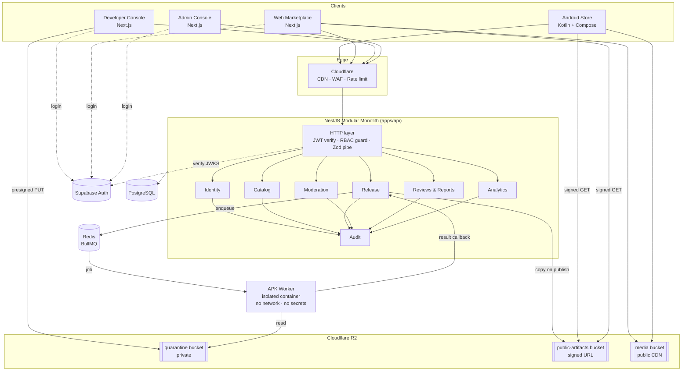
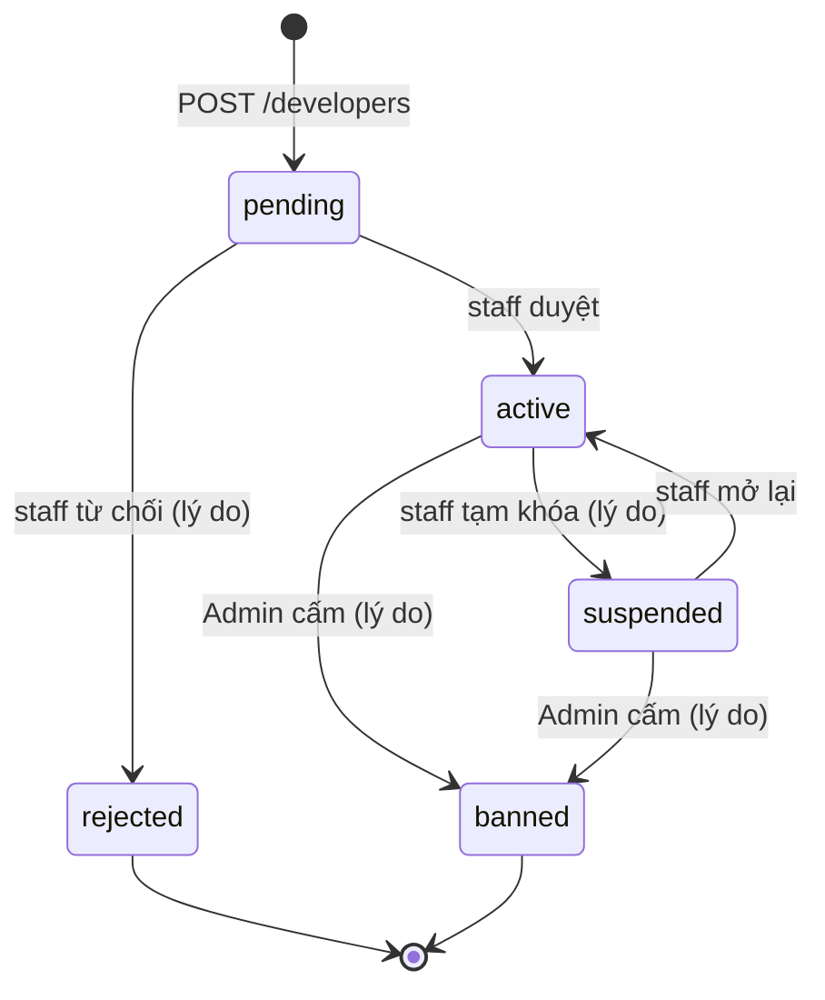

# NovaStore — Architecture

> Draft v0.1 · 2026-10-19

## 1. Nguyên tắc

1. **Modular Monolith**: một NestJS deployable, chia module có ranh giới rõ; mỗi module sở hữu bảng của mình, module khác chỉ truy cập qua service interface công khai (không query chéo bảng).
2. **Worker tách tiến trình**: mọi xử lý APK chạy trong `apps/worker`, trong container cô lập, **không bao giờ** trên tiến trình API.
3. **Artifact bất biến**: một release artifact khi đã tạo thì không sửa; thay đổi = release mới.
4. **Deny by default**: không có quyền rõ ràng → từ chối. Mọi API ghi có auth + authz + validation + audit log.
5. **Contracts first**: Zod schemas trong `packages/validation` dùng chung cho Next.js và NestJS; OpenAPI sinh từ NestJS.

## 2. Sơ đồ hệ thống



## 3. Module backend

| Module | Trách nhiệm | Bảng sở hữu |
|--------|-------------|-------------|
| `identity` | Đồng bộ user từ Supabase, roles, developer accounts, khóa tài khoản | `users`, `user_roles`, `developer_accounts`, `developer_members` |
| `catalog` | App, metadata, danh mục, media, tìm kiếm full-text, trạng thái hiển thị | `apps`, `app_categories`, `app_media`, `app_listings` |
| `release` | Tạo release, upload session, artifact, publish/revoke, endpoint updates & download | `app_releases`, `release_artifacts`, `release_scan_results` |
| `moderation` | Hàng đợi, quyết định approve/reject, checklist | `moderation_reviews` |
| `reviews` | Đánh giá, phản hồi developer, báo cáo vi phạm | `app_reviews`, `review_replies`, `app_reports` |
| `analytics` | Ghi nhận download, tổng hợp theo ngày | `download_events`, `app_daily_stats` |
| `audit` | Append-only log thao tác quan trọng | `audit_logs` |

Giao tiếp giữa module: gọi service đồng bộ trong cùng process cho truy vấn; dùng **domain events** nội bộ (`@nestjs/event-emitter`) cho tác dụng phụ (vd. `release.published` → catalog cập nhật phiên bản hiện hành, analytics reset cache). Khi cần tách microservice sau này, event nội bộ chuyển sang queue.

## 4. Authentication & Authorization

```mermaid
sequenceDiagram
  participant C as Client
  participant S as Supabase Auth
  participant A as NestJS API
  participant DB as PostgreSQL
  C->>S: Đăng nhập (email/OAuth)
  S-->>C: access_token (JWT, ~1h) + refresh_token
  C->>A: Request + Bearer JWT
  A->>A: Verify chữ ký qua JWKS cache, kiểm exp/aud/iss
  A->>DB: Tải user + roles (mỗi request; cache Redis chưa làm)
  A->>A: RBAC guard + policy (ownership)
  A-->>C: Response
```

- **Supabase chỉ lo danh tính** (ai là ai). **Phân quyền nằm hoàn toàn trong Postgres của NovaStore** (`user_roles`, `developer_members`). Không dựa vào claim tùy biến trong JWT để quyết định quyền Moderator/Admin.
- Policy hai tầng: (1) **Role guard** — endpoint yêu cầu role nào; (2) **Resource policy** — vd. developer chỉ sửa app thuộc developer account mà họ là member.
- Moderator/Admin console bắt buộc MFA (Supabase TOTP) — kiểm `aal2` trong JWT.
- Android Store: dùng Supabase PKCE qua Custom Tab; token lưu bằng EncryptedSharedPreferences/DataStore + Keystore.

### 4.1 Vòng đời developer account (Phase 2A — đã triển khai)



| Trạng thái | Xem hồ sơ & trạng thái | Sửa hồ sơ | Phát hành (Phase 2B+) | Hồ sơ công khai |
|-----------|:---:|:---:|:---:|:---:|
| `pending` | ✓ | ✓ | ✗ | ẩn |
| `active` | ✓ | ✓ | ✓ | hiện |
| `suspended` | ✓ | ✗ | ✗ | ẩn |
| `banned` | ✓ | ✗ | ✗ | ẩn |
| `rejected` | ✓ | ✗ | ✗ | ẩn |

- Developer **không bao giờ** tự đổi trạng thái: không body nào nhận `status`, và route `/admin/developers/*` cần role staff + MFA.
- Bảng chuyển hợp lệ nằm trong `packages/types` (`DEVELOPER_STATUS_TRANSITIONS`), dùng chung cho API và UI.
- Sửa hồ sơ chỉ owner/admin của account; `editor` chỉ xem.
- Mỗi user thuộc tối đa **một** developer account (unique `developer_members.user_id`), nên "developer hiện tại" luôn xác định duy nhất. Team nhiều người trong một account vẫn được; một người thuộc nhiều account là post-MVP.

### 4.2 Phân quyền theo quyền sở hữu (ownership)

Module `apps/api/src/developers`, dùng lại ở Phase 2B–2D:

| Thành phần | Vai trò |
|-----------|--------|
| `DeveloperAccessService.resolve(userId)` | Đọc `developer_members` mới nhất từ DB → `DeveloperContext { userId, accountId, memberRole, status }`. Không dùng dữ liệu từ client. |
| `DeveloperAccessService.require(user, capability)` | `read` / `manage_profile` / `publish`; ném `403` với mã cụ thể. |
| `@RequireDeveloper(capability)` + `@CurrentDeveloper()` | Guard theo route (chạy sau AuthGuard/RolesGuard toàn cục) và tham số inject context. |
| `assertOwnsAccount(context, id)` | Tài nguyên khác account → `404` giống hệt không tồn tại. |
| `ownedWhere(context)` | `{ developerAccountId }` để mọi truy vấn tài nguyên developer (app, release…) bị giới hạn ngay ở câu SQL. |

Nguyên tắc:
1. **Phân quyền ở tầng service/DB**, không chỉ ở guard: mutation lặp lại điều kiện trạng thái trong `WHERE` (`updateMany … status IN (…)`), nên staff khóa tài khoản giữa chừng cũng không lọt (không TOCTOU).
2. **Kiểm sở hữu trước capability** trên route theo id: developer bị khóa gọi id của người khác vẫn nhận `404`, không biết được id đó có tồn tại.
3. **Chống mass assignment** bằng Zod `.strict()` và ánh xạ từng trường được phép sang Prisma `data`.
4. **Đồng thời**: unique constraint ở DB (`developer_members.user_id`, `developer_accounts.slug`) là chốt cuối; lỗi `P2002` được ánh xạ sang `409` có mã.

## 5. Luồng dữ liệu chính

### 5.1 Upload & publish
Xem chi tiết [APK_SECURITY_PIPELINE.md](APK_SECURITY_PIPELINE.md). Tóm tắt: presigned PUT vào `quarantine` → `submit` → BullMQ job → worker inspect/scan → callback ký HMAC → `pending_review` → moderator approve → API copy object sang `public-artifacts` theo key bất biến `apps/{appId}/releases/{releaseId}/{sha256}.apk` → `published`.

### 5.2 Download
`GET /apps/:id/download` → API kiểm app/release còn `published`, ghi `download_events` (dedup), trả **302** tới signed URL R2 (TTL 5 phút). Client xác minh SHA-256 sau khi tải.

### 5.3 Update check
Android Store gửi danh sách `{packageName, versionCode, signerSha256}` đã cài → API trả bản mới hơn **có cùng signer lineage**, và danh sách release đã bị **revoke** mà máy đang cài.

## 6. Background jobs (BullMQ)

| Queue | Job | Retry | Ghi chú |
|-------|-----|-------|---------|
| `apk-processing` | `inspect-and-scan` | 3, backoff exp | Chạy trên worker cô lập |
| `artifact` | `promote-to-public`, `purge-quarantine` | 5 | Purge quarantine sau 30 ngày với release bị reject |
| `analytics` | `rollup-daily` | 3 | Cron 00:15 UTC+7 |
| `notifications` | `email-developer` | 5 | Kết quả duyệt, report |

Idempotency: mọi job có `jobId` xác định (vd. `inspect:{artifactId}`) để tránh xử lý trùng.

## 7. Triển khai (đề xuất, chưa chốt)

| Thành phần | Lựa chọn MVP |
|------------|-------------|
| Next.js apps | Vercel hoặc Cloudflare Pages |
| API | Fly.io / Railway (1–2 instance) |
| Worker | VM/container riêng (Fly Machines hoặc VPS) — gVisor/Firecracker nếu có, `--network none`, rootfs read-only |
| Postgres | Supabase Postgres hoặc Neon (DB riêng cho NovaStore, không dùng chung schema `auth`) |
| Redis | Upstash / Redis managed |
| R2 | 3 bucket: `quarantine`, `public-artifacts`, `media` |

Môi trường: `local` (docker-compose), `staging`, `production`. Secrets qua env của nền tảng, không commit.

## 8. Quan sát & vận hành

- Sentry cho cả 4 frontend, API, worker; `requestId`/`jobId` truyền xuyên suốt.
- Log JSON (pino); không log token, email đầy đủ, hay URL đã ký.
- Health: `/healthz` (liveness), `/readyz` (DB + Redis).
- Backup Postgres hằng ngày; R2 bật versioning cho `public-artifacts`.

## 9. Monorepo

```
novastore/
├── apps/{web,developer,admin,api,worker,android}
├── packages/{ui,web-auth,database,types,validation,config}
├── infrastructure/{docker,scripts}
├── docs/
├── pnpm-workspace.yaml
└── turbo.json
```

`apps/android` là project Gradle độc lập, không tham gia pnpm build graph; dùng OpenAPI spec để sinh client Kotlin (Retrofit/Ktor).

## 10. Rủi ro kiến trúc & quyết định mở

- **Supabase Auth phụ thuộc bên ngoài**: nếu Supabase sự cố thì không đăng nhập được, nhưng tải app công khai vẫn chạy (không cần auth).
- **Worker cô lập** là phần đắt và khó nhất về hạ tầng — cần chốt nền tảng hỗ trợ sandbox thật.
- **Search**: Postgres FTS không có tiếng Việt sẵn → dùng `unaccent` + cấu hình `simple` + trigram (`pg_trgm`). Chuyển Meilisearch/Typesense khi > ~10k app.
- Chưa chốt: dùng Supabase Postgres (tiện) hay DB riêng (tách rời nhà cung cấp).
