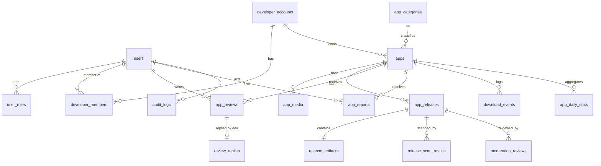
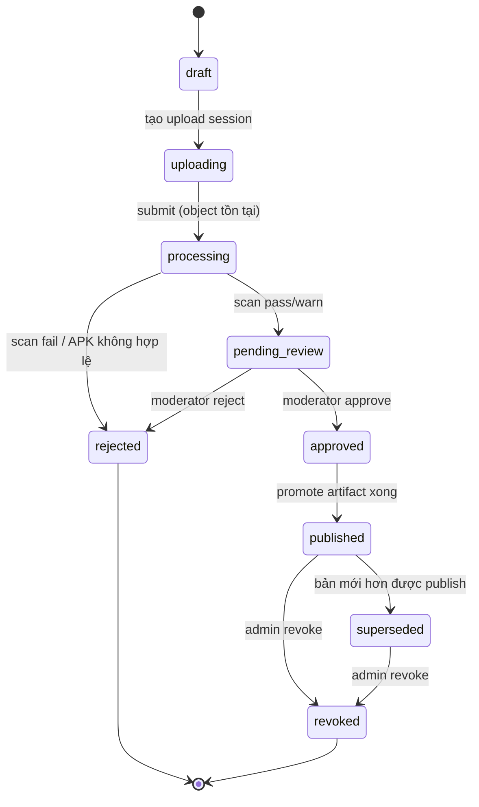

# NovaStore — Database Schema

> Draft v0.1 · PostgreSQL 16 · Prisma ORM · 2026-10-19

## 1. Quy ước

- Khóa chính `id UUID` (UUIDv7 để sắp theo thời gian). Bảng `snake_case`, cột `snake_case`.
- `created_at`, `updated_at` (`timestamptz`) cho mọi bảng trừ bảng append-only.
- Xóa mềm bằng trạng thái (`status`), không `DELETE` dữ liệu nghiệp vụ. `audit_logs` và `download_events` là append-only.
- Enum Postgres cho trạng thái; chuyển trạng thái được kiểm trong service, không phải ở DB.

## 2. Sơ đồ quan hệ

## 3. Bảng chi tiết

### Identity

**`users`** — bản sao tối thiểu của user Supabase.
| Cột | Kiểu | Ghi chú |
|-----|------|--------|
| id | uuid PK | = Supabase `auth.users.id` |
| email | citext unique | |
| display_name | text | |
| avatar_url | text null | |
| status | enum `user_status` (`active`,`suspended`,`deleted`) | |
| last_seen_at | timestamptz null | |

**`user_roles`** — `(user_id, role)` PK; `role` enum (`user`,`moderator`,`admin`). Developer **không** là role ở đây mà xác định qua `developer_members`.

**`developer_accounts`**
| Cột | Kiểu | Ghi chú |
|-----|------|--------|
| id | uuid PK | |
| slug | citext unique | dùng trong URL `/dev/{slug}` |
| display_name | text | |
| contact_email | citext | |
| website | text null | |
| verification_status | enum (`unverified`,`email_verified`,`verified`) | |
| status | enum `developer_status` (`pending`,`active`,`suspended`,`banned`,`rejected`), default `pending` | Vòng đời: [ARCHITECTURE.md §4.1](ARCHITECTURE.md#41-vòng-đời-developer-account-phase-2a--đã-triển-khai). Chỉ staff đổi được |
| status_reason | varchar(500) null | Lý do staff ghi khi rejected/suspended/banned; hiển thị cho developer |
| status_changed_at | timestamptz null | Lần đổi trạng thái gần nhất |
| agreement_version | text | phiên bản Developer Agreement đã chấp nhận |
| agreement_accepted_at | timestamptz | |

**`developer_members`** — `(developer_account_id, user_id)` PK, `member_role` enum (`owner`,`admin`,`editor`). **Unique `user_id`** (Phase 2A): mỗi user thuộc tối đa một developer account; chặn đăng ký trùng ở tầng DB kể cả khi đồng thời. Một account vẫn có thể có nhiều thành viên.

**Migration Phase 2A** (không đổi dữ liệu hiện có):
1. `20261020000000_developer_status_values` — chỉ `ALTER TYPE … ADD VALUE` `pending` (trước `active`) và `rejected` (sau `banned`). Tách riêng vì Postgres không cho dùng giá trị enum mới trong cùng transaction.
2. `20261020000100_developer_lifecycle` — thêm `status_reason`, `status_changed_at` (nullable); đổi DEFAULT sang `pending` (tài khoản cũ giữ trạng thái); thay index `developer_members(user_id)` bằng unique index. Nếu DB đã có user thuộc nhiều account, migration dừng và rollback toàn bộ — không xóa dữ liệu, cần xử lý thủ công.

Đã kiểm chứng trên Postgres (PGlite): nâng cấp DB Phase 1 có dữ liệu giữ nguyên trạng thái cũ; dữ liệu trùng làm migration rollback trọn vẹn; `prisma migrate deploy` + `drift-check` sạch.

### Catalog

**`app_categories`** — `id`, `slug` unique (không sửa được), `name_vi`, `name_en`, `icon`, `sort_order`, `is_active` bool default `true` (Phase 2B: ẩn thay vì xóa khi đang có app), `parent_id` null (MVP 1 cấp). Chỉ Admin quản lý; developer và trang công khai chỉ thấy danh mục `is_active`.

**`apps`**
| Cột | Kiểu | Ghi chú |
|-----|------|--------|
| id | uuid PK | |
| developer_account_id | uuid FK | **Bất biến** (trigger `apps_identity_guard`): không chuyển quyền sở hữu qua UPDATE |
| package_name | text unique null | Developer khai báo khi tạo app (Phase 2B); unique toàn hệ thống; CHECK định dạng Android. **Bất biến** (trigger): chỉ gán khi đang NULL, hoặc về NULL khi app chưa từng phát hành chuyển sang `archived` |
| pending_package_name | text null | Package name đã giải phóng của app archived chưa từng phát hành (lưu để tra cứu) |
| signer_lineage_sha256 | text[] | danh sách SHA-256 chứng chỉ hợp lệ (gốc + rotation) |
| slug | citext unique | |
| title | text (≤ 50) | |
| short_description | text (≤ 80) | |
| full_description | text (≤ 4000) | |
| category_id | uuid FK | |
| content_rating | enum (`everyone`,`teen`,`mature`) | tự khai, moderator xác nhận |
| contains_ads | bool | tự khai |
| privacy_policy_url | text null | https; bắt buộc nếu xin quyền nhạy cảm (kiểm ở Phase 3) |
| support_email | citext null | Phase 2B; API bắt buộc khi tạo app |
| support_url | text null | Phase 2B; https |
| default_locale | text default `vi` | |
| status | enum `app_status` (`draft`,`pending_review`,`published`,`rejected`,`suspended`,`unlisted`,`removed`,`archived`) | Vòng đời: [ARCHITECTURE.md §4.3](ARCHITECTURE.md#43-vòng-đời-ứng-dụng-phase-2b--đã-triển-khai) |
| removed_reason | text null | |
| current_release_id | uuid FK null | release đang phân phối |
| rating_avg | numeric(2,1) | denormalized |
| rating_count | int | |
| download_count | bigint | denormalized từ stats |
| search_vector | tsvector | generated: unaccent(title) A, developer name B, short_desc B, full_desc C |

Index: GIN(`search_vector`), GIN trigram(`title`), (`status`, `category_id`, `download_count desc`), (`developer_account_id`, `status`, `updated_at desc`) cho danh sách app của developer.

**Migration Phase 2B** (không đổi dữ liệu hiện có):
1. `20261020000200_app_status_lifecycle` — `RENAME VALUE 'in_review' TO 'pending_review'` (hàng cũ tự mang giá trị mới, không ép kiểu hay tạo lại enum), thêm `rejected`, `suspended`, `archived`.
2. `20261020000300_app_management` — `app_categories.is_active`; `apps.support_email`, `apps.support_url`; thay index `apps(developer_account_id)` bằng index ghép; CHECK `apps_package_name_format`; trigger `apps_identity_guard`. Dữ liệu cũ vi phạm CHECK → migration dừng và rollback.

Đã kiểm chứng trên Postgres (PGlite): DB trạng thái 2A có app `in_review` nâng cấp thành `pending_review`, dữ liệu giữ nguyên; trigger và CHECK hoạt động; `prisma migrate deploy` (5 migration) + `drift-check` sạch.

**`app_media`** — `id`, `app_id`, `type` enum (`icon`,`feature_graphic`,`screenshot_phone`,`screenshot_tablet`), `r2_key`, `width`, `height`, `sha256`, `sort_order`, `status` (`pending`,`approved`,`rejected`). Media cũng phải được moderator duyệt cùng release.

### Release

**`app_releases`**
| Cột | Kiểu | Ghi chú |
|-----|------|--------|
| id | uuid PK | |
| app_id | uuid FK | |
| version_code | bigint | từ APK; unique (`app_id`,`version_code`) |
| version_name | text | |
| changelog_vi / changelog_en | text | |
| status | enum `release_status` | xem vòng đời bên dưới |
| rejection_reason_code | text null | |
| rejection_note | text null | |
| submitted_at, approved_at, published_at, revoked_at | timestamptz null | |
| revoke_reason | text null | |
| created_by | uuid FK users | |

**`release_artifacts`** — 1–1 với release, **bất biến** sau khi tạo.
| Cột | Kiểu | Ghi chú |
|-----|------|--------|
| id | uuid PK | |
| release_id | uuid FK unique | |
| quarantine_key | text | key trong bucket quarantine |
| public_key | text null | set khi publish |
| size_bytes | bigint | |
| sha256 | char(64) | do worker tính, không tin client |
| package_name | text | |
| version_code / version_name | | |
| min_sdk / target_sdk | int | |
| permissions | text[] | |
| features | text[] | uses-feature |
| native_abis | text[] | |
| signing_schemes | text[] | v1/v2/v3/v4 |
| signer_cert_sha256 | text[] | |
| signer_lineage | jsonb null | v3 rotation lineage |
| manifest_summary | jsonb | activities/services/receivers exported, debuggable, usesCleartextTraffic |
| uploaded_sha256_claimed | char(64) null | client khai báo, chỉ để đối chiếu |

**`release_scan_results`** — `id`, `release_id`, `scanner` (`structure`,`signature`,`manifest_rules`,`clamav`,`yara`,`virustotal`…), `scanner_version`, `verdict` enum (`pass`,`warn`,`fail`,`error`), `risk_score` int 0–100, `findings` jsonb, `started_at`, `finished_at`.

**`moderation_reviews`** — `id`, `release_id`, `moderator_id`, `decision` enum (`approve`,`reject`,`request_changes`), `reason_code`, `note`, `checklist` jsonb, `created_at`. Append-only; quyết định mới nhất có hiệu lực.

### Community

**`app_reviews`** — `id`, `app_id`, `user_id`, `rating` smallint 1–5, `body` text ≤ 1000, `version_code` (bản người dùng đang dùng), `status` (`visible`,`hidden`,`removed`). Unique (`app_id`,`user_id`).

**`review_replies`** — `review_id` PK/FK, `developer_account_id`, `body`, timestamps.

**`app_reports`** — `id`, `app_id`, `release_id` null, `reporter_id` null (guest được report có captcha… *quyết định mở*), `reason` enum (`malware`,`impersonation`,`copyright`,`inappropriate`,`privacy`,`other`), `details`, `status` (`open`,`triaged`,`actioned`,`dismissed`), `handled_by`, `resolution_note`.

### Analytics

**`download_events`** — append-only, partition theo tháng.
| Cột | Kiểu | Ghi chú |
|-----|------|--------|
| id | bigint identity | |
| app_id, release_id | uuid | |
| user_id | uuid null | |
| client | enum (`web`,`android_store`) | |
| client_fingerprint | char(64) | HMAC(ip /24 + UA + ngày, secret) — không lưu IP thô |
| country | char(2) null | từ header Cloudflare |
| is_counted | bool | false nếu trùng fingerprint trong 24h |
| created_at | timestamptz | |

**`app_daily_stats`** — (`app_id`, `date`) PK, `downloads`, `unique_downloads`, `new_reviews`, `rating_sum`.

### Audit

**`audit_logs`** — `id` bigint, `actor_id` null (system), `actor_role`, `action` (vd. `release.approve`), `target_type`, `target_id`, `before` jsonb, `after` jsonb, `ip_hash`, `request_id`, `created_at`. Quyền DB: role ứng dụng chỉ được `INSERT`/`SELECT`, không `UPDATE`/`DELETE`.

## 4. Vòng đời trạng thái

`app.status` suy ra: `draft` khi chưa có release published; `published` khi `current_release_id` hợp lệ; `removed` do admin; `unlisted` do developer/admin ẩn khỏi tìm kiếm nhưng vẫn link trực tiếp được.

## 5. Ràng buộc nghiệp vụ quan trọng

1. `version_code` của release mới **>** version_code của release đang published.
2. `release_artifacts.package_name` = `apps.package_name` (hoặc `pending_package_name` cho release đầu).
3. Chứng chỉ ký phải thuộc `apps.signer_lineage_sha256`, hoặc artifact có v3 lineage chứng minh rotation từ chứng chỉ cũ → khi đó cập nhật lineage.
4. `package_name` unique toàn hệ thống kể cả app `removed` (không tái sử dụng để tránh chiếm đoạt cập nhật).
5. Mọi chuyển trạng thái của `app_releases` và `apps` ghi `audit_logs` trong cùng transaction.

## 6. Quyết định mở

- Report từ Guest có cho phép không (spam vs. kênh báo malware)?
- Có lưu đa ngôn ngữ cho listing ngay MVP (`app_listings` theo locale) hay chỉ `vi` + `en` cột cố định? Đề xuất MVP: cột cố định cho changelog, listing chỉ 1 locale.
- Thời gian giữ `download_events` thô (đề xuất 13 tháng rồi chỉ giữ rollup).
