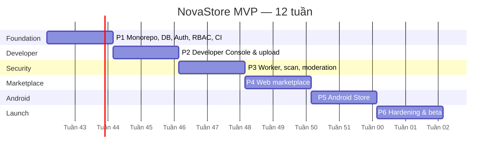

# NovaStore — MVP Roadmap

> Draft v0.1 · 2026-10-19 · Giả định: 1 full-stack developer + AI hỗ trợ, 12 tuần. Đây là kế hoạch tham vọng cho **beta giới hạn**, không phải sản phẩm có độ bảo mật/vận hành ngang Google Play.

## 1. Thứ tự ưu tiên

Developer Console + pipeline kiểm duyệt **trước** Store cho người dùng. Mỗi phase kết thúc bằng một demo end-to-end chạy được, không chỉ "xong giao diện".

## 2. Chi tiết từng phase

### Phase 1 — Foundation (Tuần 1–2)
- pnpm + Turborepo; `apps/{web,developer,admin,api,worker}`, `packages/{ui,web-auth,database,types,validation,config}`.
- Prisma schema đợt 1 (identity, catalog, release, audit), migration, seed (categories, admin user).
- NestJS: config, logger (pino), Sentry, `/healthz`, JWT verify Supabase (JWKS), RBAC guard, AuditService ghi trong cùng transaction, Problem Details filter, rate limit.
- docker-compose local: Postgres, Redis, SeaweedFS (giả lập R2 qua S3 API; MinIO đã ngừng phát hành image cộng đồng).
- `packages/ui`: token + component cơ bản; 3 Next.js app có layout + đăng nhập.
- GitHub Actions: lint, typecheck, test, build; Prisma migrate check.
- **Demo:** đăng nhập ở cả 3 console; user thường bị 403 ở Admin.

### Phase 2 — Developer Console (Tuần 3–4)
- Tạo developer account, Developer Agreement.
- CRUD app (wizard 5 bước), media upload presigned + kiểm định dạng/kích thước ảnh.
- Release draft, upload session vào quarantine, submit → enqueue (worker giả lập trả kết quả cố định).
- **Demo:** developer tạo app, upload APK, thấy release ở `processing`.

### Phase 3 — Security & Moderation (Tuần 5–6)
- Image worker (build-tools, androguard, ClamAV, YARA), Job Relay, sandbox `--network none`.
- Validation + inspection + quy tắc chữ ký/package/versionCode + scan + risk score.
- Callback HMAC, chuyển trạng thái, email kết quả.
- Admin Console: queue, review workspace, approve/reject, promote artifact, remove app, revoke release, suspend developer, audit log viewer.
- Bộ APK test: hợp lệ, debug-signed, sai chữ ký, versionCode lùi, zip bomb, EICAR-in-APK.
- **Demo:** APK tốt → duyệt → published; APK xấu → reject tự động với mã lỗi đúng.

### Phase 4 — Public Marketplace (Tuần 7–8)
- Home, danh mục, tìm kiếm (FTS + unaccent + trigram), chi tiết app, trang developer.
- Download qua signed URL + `download_events` + rollup daily; thống kê trong Developer Console.
- Review/rating, developer reply, report.
- SEO, sitemap, OG.
- **Demo:** guest tìm và tải APK đã duyệt; user đánh giá; developer thấy lượt tải.

### Phase 5 — Android Store (Tuần 9–10)
- Compose app: 4 tab, chi tiết app, đăng nhập PKCE.
- Download manager (WorkManager, resume), xác minh SHA-256 + chữ ký, `PackageInstaller` session, onboarding "Install unknown apps".
- Quản lý app: liệt kê app cài từ NovaStore (`getInstallSourceInfo` / so khớp catalog), `/updates/check`, cảnh báo revoked.
- Ký release Store bằng keystore riêng, phân phối APK Store qua chính website.
- **Demo:** cài app từ Store trên máy thật Android 10 và 15; cập nhật lên bản mới.

### Phase 6 — Beta Launch (Tuần 11–12)
- E2E: Playwright (web/console), Espresso/Maestro (Android) cho luồng ở [ACCEPTANCE_CRITERIA.md](ACCEPTANCE_CRITERIA.md).
- Security review: OWASP ASVS L1 checklist, kiểm IDOR mọi endpoint, pen-test nội bộ upload/worker.
- Backup + thử restore; dashboard monitoring; runbook sự cố (malware đã phát hành, rò rỉ khóa, R2 sự cố).
- Trang pháp lý: Điều khoản, Chính sách riêng tư, Developer Agreement, quy trình khiếu nại/gỡ nội dung, `security.txt`.
- Mời 10–30 developer beta.

## 3. Rủi ro tiến độ

| Rủi ro | Dự phòng |
|--------|---------|
| Sandbox worker tốn thời gian hơn dự kiến | Bắt đầu spike hạ tầng worker ngay từ tuần 2 |
| Android install flow khác biệt theo hãng (Xiaomi, Samsung, Oppo) | Test sớm trên máy thật; giữ fallback "mở bằng trình cài hệ thống" |
| Scope creep | Mọi tính năng mới vào backlog post-MVP trừ khi chặn tiêu chí nghiệm thu |
| 1 người làm toàn bộ | Có thể cắt: Admin Console tối giản (chỉ queue + review), web chưa cần trang developer |

## 4. Post-MVP

| Tính năng | Giai đoạn | Ghi chú |
|-----------|-----------|--------|
| Paid apps / IAP / Subscription | V2 | Cần cổng thanh toán, thuế, hoàn tiền |
| Quảng cáo app trong Store | V2 | |
| AI recommendation | V2 | Cần đủ dữ liệu tương tác |
| A/B testing listing | V2 | |
| Public Developer API / CLI upload | V2 | CI/CD của developer |
| Dynamic analysis (emulator sandbox) | V2 | |
| Hai người duyệt cho app rủi ro cao | V2 | |
| Meilisearch/Typesense | Khi > 10k app | |
| Split APK / AAB | Sau MVP | Cần thiết kế xử lý & ký — không ký thay developer |
| Auto-update (Android 12+ `setRequireUserAction`) | Sau MVP | Chỉ khi Store là installer của app và đáp ứng điều kiện Android |
| Đa ngôn ngữ listing | Sau MVP | |
| Team developer nhiều thành viên | Sau MVP | Schema đã sẵn |
| iOS | Ngoài phạm vi | |
